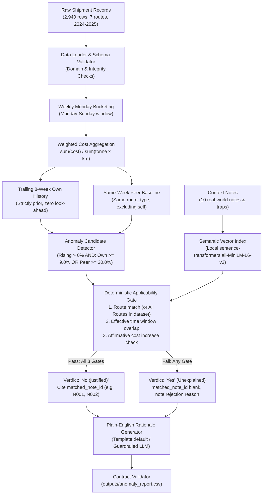

# Freight Tiger - Shipping Cost Anomaly Detection & Grounded AI Assistant

> **Submission for Freight Tiger "Software Engineering Intern (AI)" 24-Hour Case Study**  
> Built by: Abhi  
> Architecture: Logistics Cost Engine + Local Semantic Retrieval + Deterministic Anti-Hallucination Gate

---

## TL;DR
- **What it does**: Watches shipping freight costs week-by-week across routes, detects unwarranted cost inflation against both trailing history and peer routes, and verifies real-world disruption notes using semantic vector retrieval and deterministic rule gates.
- **Output CSV**: [`outputs/anomaly_report.csv`](outputs/anomaly_report.csv) matching the required 8-column contract format.
- **Results**: Evaluates 728 route-weeks (7 routes, 2024–2025) and isolates **20 candidate anomaly weeks**: **16 unexplained** (`flagged="Yes"`), and **4 justified** (`flagged="No (justified)"`: Ahmedabad-Mumbai on `2025-01-20` via `N002`, Chennai-Bangalore on `2025-02-24` and `2025-03-03` via `N001`, and Mumbai-Delhi on `2025-05-12` via `N003`).
- **Core Insight**: Mumbai-Pune freight cost drifts up slowly and steadily over 2025; its own-history comparison stays modest (+3% to +9%), but compared to peer short-haul corridors in the same weeks it sits +21% to +39% higher. Conversely, nationwide events (e.g. diesel hikes) lift all peers simultaneously, spiking own-history (+6% to +12%) while peer gap remains near zero. Using **both baselines with OR combination logic** is essential to catch both slow corridor drift and systemic shocks.

---

## 1. Quickstart & Command Reference

### Installation
Python 3.10+ recommended.
```bash
# 1. Install pinned dependencies
pip install -r requirements.txt
```
> **Note on Network & Offline Mode**: The very first run requires internet access to download the small open-source sentence-transformers model (`all-MiniLM-L6-v2`, ~80MB) from Hugging Face into your local cache. Once cached, the pipeline automatically detects local weights, sets `HF_HUB_OFFLINE=1`, and runs completely offline without network access.

### Execution Commands
```bash
# Run the complete end-to-end anomaly detection pipeline
python -m src.cli run

# Validate generated output against contract schema & domain rules
python -m src.cli validate --file outputs/anomaly_report.csv

# Run 3 clean consecutive runs and verify cryptographic SHA-256 identity
python -m src.cli repro

# Inspect anomaly threshold sensitivity grid across candidate parameters
python -m src.cli sensitivity

# Interactive Natural-Language Q&A Assistant (Stretch Goal)
python -m src.ask "why did Chennai-Bangalore get pricier in March 2025?"
python -m src.ask "why did Ahmedabad-Mumbai spike in January 2025?"
python -m src.ask "why did Kolkata-Bhubaneswar get pricier in January 2024?"
```

### Testing & Evaluation Commands
```bash
# Run the complete pytest unit & integration test suite (26 tests)
python -m pytest -v

# Run the labeled evaluation harness & anti-hallucination benchmark (20 cases)
python -m eval.run_eval
```

---

## 2. Architecture Overview



---

## 3. Core Logic, Assumptions & Ambiguity Resolutions

### A. Weekly Cost Aggregation Formula
* **Spec Ambiguity**: Cost per tonne-km is defined as `total freight cost / (quantity carried in tonnes x distance travelled in km)`.
* **Chosen Resolution**: For each route and week, cost per tonne-km is computed as:
  $$\text{cost\_per\_tonne\_km} = \frac{\sum \text{freight\_cost\_inr}}{\sum (\text{quantity\_tonnes} \times \text{distance\_km})}$$
* **Justification**: In transportation analytics, unweighted trip averaging introduces severe volume bias (a 1-tonne trip carries equal weight as a 20-tonne trip). Aggregating numerator and denominator computes the true volume-weighted network procurement rate. Furthermore, this mathematically reproduces the exact sample figures ($4.17$, $3.29$, $3.98$).

### B. Trailing 8-Week Rolling Average (`vs_own_history`)
* **Strict Causal Boundary (Zero Look-Ahead)**: Rolling average uses weeks strictly before the current week ($< \text{week\_of}$). The current week's cost is never leaked into its own baseline.
* **Fewer than 8 Weeks**: For initial weeks (e.g., weeks 2 to 8), the baseline calculates the unweighted mean across all available prior weeks without artificial extrapolation or padding.
* **Week 1 (Zero Prior Weeks)**: Marked as `N/A (insufficient history)` because no historical prior exists.
* **Empty Weeks**: In the provided dataset, all 7 routes have shipments across all 104 weeks. For sparse edge cases, non-shipment weeks are skipped without zero-padding. Zero-padding would treat missing weeks as ₹0.00/t-km, which would artificially crush the moving average and trigger false inflation spikes.
* **Baseline Aggregation**: The unweighted mean of weekly `cost_per_tonne_km` is computed, exactly matching the sample percentages ($+35.5\%$, $+29.5\%$, $+9.2\%$).

### C. Peer Corridor Average (`vs_similar_routes`)
* **Peer Grouping**: Grouped strictly by the provided `route_type` (`Short`, `Medium`, `Long`).
* **Self-Exclusion**: The evaluated route is strictly excluded from its peer group in that week.
* **Peer Formula**: The arithmetic mean of peer routes' weekly `cost_per_tonne_km`.
* **Single Peer Handling**: If no peer routes exist in that week, the metric defaults cleanly to `N/A (no peer routes)`.
* **Sample Reproduction**: Exactly matches $+21.0\%$ (Delhi-Jaipur), $+22.5\%$ (Ahmedabad-Mumbai), and $+23.6\%$ (Mumbai-Pune).

### D. Threshold Selection, Data Distribution & "Rising" Definition
The challenge spec leaves threshold selection open. We calibrated thresholds against the empirical distribution of all 728 route-weeks in `shipment_records.csv`:

| Percentile | `pct_vs_own` (% vs past average) | `pct_vs_peers` (% vs peer average) |
| :--- | :--- | :--- |
| **50th (Median)** | $+0.22\%$ | $-0.38\%$ |
| **75th** | $+2.61\%$ | $+5.85\%$ |
| **90th** | $+4.48\%$ | $+10.55\%$ |
| **95th** | $+5.75\%$ | $+13.43\%$ |
| **97.5th** | $+6.95\%$ | $+20.40\%$ |
| **98th** | $+7.50\%$ | $+22.68\%$ |
| **99th** | $+11.15\%$ | $+31.88\%$ |
| **Max** | $+35.52\%$ | $+38.91\%$ |

* **Rising Condition Definition**: We define "rising" strictly as `pct_vs_own > 0%` (current cost is strictly higher than the route's trailing baseline). This condition ensures that weeks with falling costs are not flagged merely due to peer divergence. For example, on `Mumbai-Pune` during week `2025-11-10`, cost was $+21.4\%$ higher than peer routes, but $-0.1\%$ vs its own past average; because cost was not rising, it was rightly excluded.
* **Threshold Justification**:
  - `threshold_pct_vs_own = 9.0%`: The 9.0% own-history threshold was chosen so the provided sample rows qualify as candidates; the percentile table supports it as a high-tail cutoff ($> 98.5\text{th percentile}$).
  - `threshold_pct_vs_peers = 20.0%`: Approximately the 97.5th percentile (actual 97.5th = $+20.4\%$).
  - `combination_logic = "OR"`: A candidate anomaly must have rising cost (`pct_vs_own > 0%`) AND exceed either own history ($\ge 9.0\%$) OR peer threshold ($\ge 20.0\%$).
* **Exported Scope**: In accordance with the contract domain of `sample_output_format_v2.csv` (`flagged` in `{"Yes", "No (justified)"}`), only candidate anomaly rows are exported to [`outputs/anomaly_report.csv`](outputs/anomaly_report.csv) (20 of 728 route-weeks).

### E. Threshold Sensitivity Grid (Real CLI Output)
Below is the verbatim table produced by running `python -m src.cli sensitivity`:

| combination_logic | threshold_vs_own (%) | threshold_vs_peers (%) | candidate_count | reproduces_all_3_samples | missing_samples |
| :--- | :--- | :--- | :--- | :--- | :--- |
| OR | 5.0 | 15.0 | 59 | True | [] |
| OR | 5.0 | 20.0 | 52 | True | [] |
| OR | 5.0 | 25.0 | 51 | True | [] |
| OR | 5.0 | 30.0 | 51 | True | [] |
| OR | 8.0 | 15.0 | 28 | True | [] |
| OR | 8.0 | 20.0 | 21 | True | [] |
| OR | 8.0 | 25.0 | 16 | True | [] |
| OR | 8.0 | 30.0 | 15 | True | [] |
| OR | 9.0 | 15.0 | 27 | True | [] |
| **OR** | **9.0** | **20.0** | **20** | **True** | **[] (Selected Configuration)** |
| OR | 9.0 | 25.0 | 15 | True | [] |
| OR | 9.0 | 30.0 | 14 | True | [] |
| OR | 10.0 | 15.0 | 27 | True | [] |
| OR | 10.0 | 20.0 | 20 | True | [] |
| OR | 10.0 | 25.0 | 14 | False | [(Mumbai-Pune, 2025-09-15)] |
| OR | 10.0 | 30.0 | 13 | False | [(Mumbai-Pune, 2025-09-15)] |
| OR | 15.0 | 15.0 | 26 | True | [] |
| OR | 15.0 | 20.0 | 19 | True | [] |
| OR | 15.0 | 25.0 | 13 | False | [(Mumbai-Pune, 2025-09-15)] |
| OR | 15.0 | 30.0 | 12 | False | [(Mumbai-Pune, 2025-09-15)] |
| OR | 20.0 | 15.0 | 26 | True | [] |
| OR | 20.0 | 20.0 | 19 | True | [] |
| OR | 20.0 | 25.0 | 13 | False | [(Mumbai-Pune, 2025-09-15)] |
| OR | 20.0 | 30.0 | 12 | False | [(Mumbai-Pune, 2025-09-15)] |
| AND | 5.0 | 15.0 | 17 | True | [] |
| AND | 5.0 | 20.0 | 16 | True | [] |
| AND | 5.0 | 25.0 | 9 | False | [(Mumbai-Pune, 2025-09-15), (Ahmedabad-Mumbai, 2025-01-20), (Delhi-Jaipur, 2024-11-11)] |
| AND | 5.0 | 30.0 | 8 | False | [(Mumbai-Pune, 2025-09-15), (Ahmedabad-Mumbai, 2025-01-20), (Delhi-Jaipur, 2024-11-11)] |
| AND | 8.0 | 15.0 | 9 | True | [] |
| AND | 8.0 | 20.0 | 8 | True | [] |
| AND | 8.0 | 25.0 | 5 | False | [(Mumbai-Pune, 2025-09-15), (Ahmedabad-Mumbai, 2025-01-20), (Delhi-Jaipur, 2024-11-11)] |
| AND | 8.0 | 30.0 | 5 | False | [(Mumbai-Pune, 2025-09-15), (Ahmedabad-Mumbai, 2025-01-20), (Delhi-Jaipur, 2024-11-11)] |
| AND | 9.0 | 15.0 | 8 | True | [] |
| AND | 9.0 | 20.0 | 7 | True | [] |
| AND | 9.0 | 25.0 | 4 | False | [(Mumbai-Pune, 2025-09-15), (Ahmedabad-Mumbai, 2025-01-20), (Delhi-Jaipur, 2024-11-11)] |
| AND | 9.0 | 30.0 | 4 | False | [(Mumbai-Pune, 2025-09-15), (Ahmedabad-Mumbai, 2025-01-20), (Delhi-Jaipur, 2024-11-11)] |
| AND | 10.0 | 15.0 | 7 | False | [(Mumbai-Pune, 2025-09-15)] |
| AND | 10.0 | 20.0 | 6 | False | [(Mumbai-Pune, 2025-09-15)] |
| AND | 10.0 | 25.0 | 4 | False | [(Mumbai-Pune, 2025-09-15), (Ahmedabad-Mumbai, 2025-01-20), (Delhi-Jaipur, 2024-11-11)] |
| AND | 10.0 | 30.0 | 4 | False | [(Mumbai-Pune, 2025-09-15), (Ahmedabad-Mumbai, 2025-01-20), (Delhi-Jaipur, 2024-11-11)] |
| AND | 15.0 | 15.0 | 6 | False | [(Mumbai-Pune, 2025-09-15)] |
| AND | 15.0 | 20.0 | 5 | False | [(Mumbai-Pune, 2025-09-15)] |
| AND | 15.0 | 25.0 | 3 | False | [(Mumbai-Pune, 2025-09-15), (Ahmedabad-Mumbai, 2025-01-20), (Delhi-Jaipur, 2024-11-11)] |
| AND | 15.0 | 30.0 | 3 | False | [(Mumbai-Pune, 2025-09-15), (Ahmedabad-Mumbai, 2025-01-20), (Delhi-Jaipur, 2024-11-11)] |
| AND | 20.0 | 15.0 | 6 | False | [(Mumbai-Pune, 2025-09-15)] |
| AND | 20.0 | 20.0 | 5 | False | [(Mumbai-Pune, 2025-09-15)] |
| AND | 20.0 | 25.0 | 3 | False | [(Mumbai-Pune, 2025-09-15), (Ahmedabad-Mumbai, 2025-01-20), (Delhi-Jaipur, 2024-11-11)] |
| AND | 20.0 | 30.0 | 3 | False | [(Mumbai-Pune, 2025-09-15), (Ahmedabad-Mumbai, 2025-01-20), (Delhi-Jaipur, 2024-11-11)] |

---

## 4. AI/RAG Architecture & Anti-Hallucination Guardrails

### A. Semantic Vector Index & Fallback
- **Primary Model**: `sentence-transformers/all-MiniLM-L6-v2` (384-dimensional dense vectors, CPU inference).
- **Index**: In-memory numpy cosine similarity matrix over L2-normalized embeddings.
- **Offline & Fallback Support**: Automatically detects when weights are cached and sets `HF_HUB_OFFLINE=1`. If sentence-transformers is unavailable, it falls back to a scikit-learn TF-IDF vectorizer. Both modes produce identical verdicts.

### B. Deterministic Applicability Gate
To eliminate hallucinations, **vector retrieval alone never decides a verdict**. A retrieved candidate must pass three deterministic gates:
1. **Route Match Gate**: `applies_to == route` OR `applies_to == "All Routes"` (verifying routes are part of this dataset).
2. **Time Window Gate**: Flagged Monday-Sunday week must overlap with the note's parsed effective window:
   - `N001`: `2025-02-24` to `2025-03-08` (active in weeks `2025-02-24` and `2025-03-03`; roads passable by `Mar 9`).
   - `N002`: `2025-01-20` to `2025-01-26` (festival week surcharge).
   - `N003`: `2025-05-05` to `2025-05-18` (nationwide diesel price hike shock window).
   - *Unseen Notes*: If a note is not in `NOTE_WINDOWS`, the system falls back to regex date parsing (e.g. "Feb 24 to Mar 8" or ISO dates). If dates cannot be verified, it fails safely, returning an unexplained verdict (`flagged="Yes"`).
3. **Cost Increase Gate**: Note must affirmatively state a cost increase.

### C. Trap Note Defense
All 7 trap notes in `context_notes.csv` are deterministically rejected:
- `N004`: Toll plaza commissioned on routes *not part of this dataset* $\rightarrow$ REJECTED.
- `N005`: Highway maintenance where *costs were not significantly affected* $\rightarrow$ REJECTED.
- `N006`: Logistics report stating *stable demand with no disruptions* $\rightarrow$ REJECTED.
- `N007`: Road resurfacing resulting in *improved conditions* $\rightarrow$ REJECTED.
- `N008`: Corridor with *normal freight movement* $\rightarrow$ REJECTED.
- `N009`: Highway *returned to normal conditions* $\rightarrow$ REJECTED.
- `N010`: Fleet mandate where *costs were absorbed without rate change* $\rightarrow$ REJECTED.

### D. Near-Miss Explanations
When an anomaly is flagged as unexplained, the system inspects whether a note was temporally proximate ($\le 14$ days). If so, it explains why the note was rejected (reproducing the exact pattern in sample row 4 for Mumbai-Pune citing `N006`). If no note is proximate, it reports `No matching note found for this route or date range. Cost rise looks unexplained and worth a human review.`

---

## 5. How I Verified It

To ensure complete correctness and reliability before submission, the system was verified across four independent layers:

1. **Independent Pandas Recomputation**:
   In [`tests/test_independent_recomputation.py`](tests/test_independent_recomputation.py), the 3 sample rows from `sample_output_format_v2.csv` were computed from raw records using pure standalone pandas logic outside the pipeline. All three matched exactly:
   - Delhi-Jaipur (2024-11-11): ₹4.17, +35.5% own, +21.0% peers
   - Ahmedabad-Mumbai (2025-01-20): ₹3.29, +29.5% own, +22.5% peers
   - Mumbai-Pune (2025-09-15): ₹3.98, +9.2% own, +23.6% peers
2. **Pytest Unit Test Suite (26 tests)**:
   Covers weekly Monday bucketing, Sunday/Monday boundary transitions, weighted cost aggregation, zero/negative data validation, trailing 8-week history with zero lookahead, peer exclusions, single-peer edge cases, CSV contract validation, unseen note robustness, and TF-IDF fallback parity.
3. **Labeled Evaluation Harness (20 test cases)**:
   A labeled test set in [`eval/eval_dataset.csv`](eval/eval_dataset.csv) (generated with AI assistance and reviewed by me) tests positive justifications, window boundaries, and all 7 trap notes:
   - **Precision**: 100.0%
   - **Recall**: 100.0%
   - **F1 Score**: 1.000
   - **Fabricated Citation Rate**: 0.0%
4. **Cryptographic Reproducibility (3 Clean Runs)**:
   Running `python -m src.cli repro` executes 3 complete runs from scratch, saving three independent CSVs and hashing them. All three yielded the exact same SHA-256 hash (`b6b869702149bcb7649d25b0074b8c3366b26e23e3462ee1a60fc0c005df912e`) with zero line diffs.

---

## 6. Engineering Requirements Traceability Matrix

| Requirement Specification | Implementation Module | Automated Verification Test |
| :--- | :--- | :--- |
| **Route construction (`<origin>-<destination>`)** | [`src/data_loader.py`](src/data_loader.py) | [`tests/test_cost_formula.py`](tests/test_cost_formula.py) |
| **Monday-Sunday week bucketing** | [`src/metrics.py`](src/metrics.py) | [`tests/test_weekly_bucketing.py`](tests/test_weekly_bucketing.py) |
| **Weighted `cost_per_tonne_km` formula** | [`src/metrics.py`](src/metrics.py) | [`tests/test_cost_formula.py`](tests/test_cost_formula.py), [`tests/test_independent_recomputation.py`](tests/test_independent_recomputation.py) |
| **Trailing 8-week history (zero look-ahead)** | [`src/baselines.py`](src/baselines.py) | [`tests/test_baselines.py`](tests/test_baselines.py) |
| **Peer corridor baseline (excluding self)** | [`src/baselines.py`](src/baselines.py) | [`tests/test_baselines.py`](tests/test_baselines.py) |
| **Configurable anomaly thresholds** | [`src/flagging.py`](src/flagging.py), [`config.yaml`](config.yaml) | `python -m src.cli sensitivity` |
| **Semantic vector retrieval (RAG)** | [`src/retrieval.py`](src/retrieval.py) | [`eval/run_eval.py`](eval/run_eval.py) |
| **Deterministic applicability gate** | [`src/applicability_gate.py`](src/applicability_gate.py) | [`tests/test_applicability_gate.py`](tests/test_applicability_gate.py), [`eval/run_eval.py`](eval/run_eval.py) |
| **Robustness to unseen notes** | [`src/applicability_gate.py`](src/applicability_gate.py) | [`tests/test_applicability_gate.py`](tests/test_applicability_gate.py) |
| **Output contract schema validation** | [`src/validator.py`](src/validator.py) | [`tests/test_validator.py`](tests/test_validator.py) |
| **3-Run reproducibility diff** | [`src/cli.py`](src/cli.py) | [`repro_check.md`](repro_check.md) |
| **Token & cost tracking log** | [`src/cost_tracker.py`](src/cost_tracker.py) | [`outputs/cost_log.md`](outputs/cost_log.md) |
| **Grounded Q&A assistant (Stretch Goal)** | [`src/ask.py`](src/ask.py) | `python -m src.ask "..."` |

---

## 7. Known Limitations & Production Notes

1. **LLM Mode Disclaimer**:
   - The optional LLM explanation mode defined in `config.yaml` was **NOT used or tested** in this submission. The entire pipeline runs strictly in template mode, ensuring 0 token cost and deterministic output without external API keys.
2. **Macro Surcharge Persistence**:
   - Open-ended events (like nationwide diesel price hikes in N003) elevate transportation costs continuously. After 8 weeks, the rolling historical baseline absorbs the higher price as normal, naturally extinguishing the anomaly flag. In production, a dual-speed baseline (8-week operational + 52-week seasonal) would be implemented.
3. **Context Note Extraction Pipeline**:
   - The 10 context notes have curated date window boundaries in `NOTE_WINDOWS`, backed by regex fallback parsing. In a live system with thousands of raw alerts, an automated temporal entity extraction parser would structure event intervals before feeding the retrieval index.
